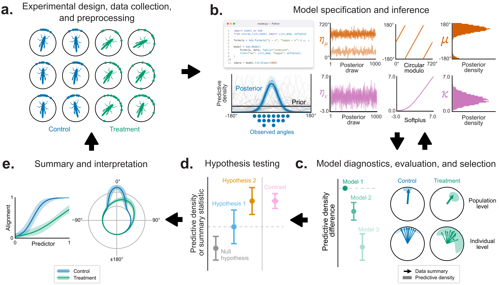

# Unwrap

<p align="center">
  <picture>
    <source media="(prefers-color-scheme: dark)" srcset="docs/assets/unwrap-logo-dark.svg">
    
  </picture>
</p>

`unwrap` provides a Bayesian workflow for circular regression: understanding how
mean direction and directional consistency vary with experimental conditions,
environmental cues, and differences between individuals. It supports analyses of
animal navigation and collective movement, from individual orientation to
alignment within groups.

The Python package works with **Bambi** and **PyMC**. Examples in **R** and
**MATLAB** are also included.

<p align="center">
  
</p>

## Python installation

Install from GitHub in a virtual environment:

```bash
python -m venv .venv
# macOS / Linux
source .venv/bin/activate
# Windows PowerShell: .venv\Scripts\Activate.ps1

python -m pip install --upgrade pip
python -m pip install git+https://github.com/jgraving/unwrap.git
```

Python 3.10 or newer is required. Install from the GitHub URL above; the
`unwrap` package on PyPI refers to a different project.

### Install with uv (optional)

With [uv installed](https://docs.astral.sh/uv/getting-started/installation/):

```bash
uv venv --python 3.12
uv pip install git+https://github.com/jgraving/unwrap.git
uv run --no-project python -c "import unwrap"
```

To add Unwrap to an existing uv project instead:

```bash
uv add git+https://github.com/jgraving/unwrap.git
```

To run the examples from a local copy of the repository:

```bash
git clone https://github.com/jgraving/unwrap.git
cd unwrap
python -m pip install -e .
```

## Quick start: circular regression in Python

This example generates synthetic angles and fits a model in which both mean
direction (`mu`) and concentration (`kappa`) depend on a predictor `x`.
It uses Bambi's model interface with links and a prior supplied by `unwrap`.

```python
import numpy as np
import bambi as bmb
import arviz as az

from unwrap.data import generate_circular_regression_data
from unwrap.link.bambi import LINKS
from unwrap.prior import CircularUniformPrior

data = generate_circular_regression_data(
    num_samples=200,
    x_range=(-1, 1),
    mean_intercept=0,
    mean_slope=1,
    conc_intercept=2,
    conc_slope=0.5,
    mean_link="circular_modulo",
    conc_link="softplus",
    seed=42,
)

model = bmb.Model(
    bmb.Formula("y ~ x", "kappa ~ x"),
    data,
    family="vonmises",
    link={"mu": LINKS["circular_modulo"], "kappa": LINKS["softplus"]},
    priors={
        "Intercept": CircularUniformPrior(),
        "x": bmb.Prior("Normal", mu=0, sigma=0.5 * np.pi),
        "kappa": {
            "Intercept": bmb.Prior("Normal", mu=2, sigma=0.5),
            "x": bmb.Prior("Normal", mu=0, sigma=1),
        },
    },
    center_predictors=False,
)

idata = model.fit(draws=1000, tune=1000, chains=4, random_seed=42)

print(
    az.summary(
        idata,
        var_names=["Intercept", "x", "kappa_Intercept", "kappa_x"],
        circ_var_names=["Intercept"],
    )
)
```

Angles are in **radians**. The `circular_modulo` link wraps the mean predictor
to `[-pi, pi)`; the `softplus` link maps the concentration predictor to positive
values. Larger `kappa` means a more concentrated distribution of angles.
`CircularUniformPrior()` approximates a uniform distribution on the circle
using a von Mises distribution with near-zero concentration.

The priors above are illustrative and should be adapted to the scale of your
predictors. Inspect sampling diagnostics and posterior predictive behaviour
before interpreting a fitted model. Use circular summaries for angular
parameters, as shown for the intercept.

See [the circular regression notebook](notebooks/circular_regression.ipynb)
for a longer example with plots.

## Examples

Start with the [circular regression tutorial](notebooks/circular_regression.ipynb)
to fit a model to simulated observations, interpret changes in mean direction and
concentration, and compare model predictions with the data.

The research examples address questions from animal navigation and collective
movement:

| Notebook | What you can explore |
| --- | --- |
| [Artificial light and dung beetle orientation](notebooks/beetles.ipynb) | Examine how a floodlight changes mean direction, within-individual directional consistency, and alignment between individuals. |
| [Grevy’s zebra escape response](notebooks/zebra_escape.ipynb) | Compare body orientation before and after a human approach, separating group reorientation, between-individual alignment, and within-individual directional consistency. |
| [Order, density, and locust alignment](notebooks/locust_density_order.ipynb) | Ask how the directional coherence and density of a virtual swarm influence a focal locust’s alignment with its neighbours. |
| [Directional decisions in marching locusts](notebooks/locust_direction_mixture_model.ipynb) | Compare optic-flow and vectorial-encoding hypotheses through their predictions of forward marching or lateral turns toward virtual neighbour groups. |
| [Periodic but not circular](notebooks/periodic_not_circular.ipynb) | Model a response that varies over a daily cycle but is not itself an angle. |
| [Goal-directed movement](notebooks/von_mises_policy.ipynb) | Explore simulated trajectories in which headings are drawn from a von Mises distribution. |

See the [notebook guide](notebooks/README.md) for data and instructions for running
the examples.

## Documentation

Visit the [documentation](https://jgraving.github.io/unwrap/) for installation,
circular regression concepts, and the Python API.

## R and MATLAB

The R and MATLAB examples have their own setup instructions. Their dependencies
are installed separately from the Python package.

### R

Start with [`R/brms_example.R`](R/brms_example.R), which uses
[`R/unwrap_family.R`](R/unwrap_family.R) to define a custom von Mises family
for brms. The example loads `brms` and `circular` and uses
[`R/vonmises_data.csv`](R/vonmises_data.csv). Its relative paths assume that
the working directory is `R/`.

Additional functions and analysis are in
[`R/unwrap_functions.R`](R/unwrap_functions.R) and
[the R Markdown analysis](R/Circular%20Dataset%20Structures.Rmd).

### MATLAB

Start with [the MATLAB setup notes](Matlab/ReadmeMATLAB.txt) and
[`Matlab/UnwrapStan.m`](Matlab/UnwrapStan.m). The Stan example requires
MatlabStan, MatlabProcessManager, and CmdStan, with paths and version settings
adjusted for your installation.

[`Matlab/MatlabOnly/`](Matlab/MatlabOnly/) contains an alternative example
using MATLAB's `hmcSampler`.

## Contributing

See the [contributor guide](docs/development.md) for development setup, testing,
and documentation builds.

## License

[Apache License 2.0](LICENSE.md).
