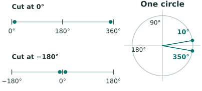

# Circular data basics

Imagine marking the direction each beetle takes as it leaves a round arena.
Two beetles leave at 350° and 10° relative to a light source. Both walk nearly
toward the light, even though their recorded numbers look far apart.

## A full turn brings you back to the same direction

The shortest turn from 350° to 10° is 20°. Averaging the numbers directly
gives 180°, which points away from both beetles' headings. To find a circular
mean, draw a unit arrow for each heading and add the arrows. Here their
sideways components cancel and the sum points toward 0°. When the arrows
cancel completely, there is no single mean direction.



*Dots mark example headings. Arrows show their circular means.*

## Where do the headings point, and how tightly do they cluster?

The two sets on the right have the same circular mean. In one set, beetles
leave in a wider range of directions. In the other, they mostly take the same
direction. A [von Mises distribution](math/von-mises.md) describes those two
features separately using **mean direction** and **concentration**. Higher
concentration means less spread among the headings. It answers a different
question from how precisely the mean direction itself has been estimated.

**Try it.** Suppose the light moves and every beetle turns by the same
amount. Which feature changes? The mean direction shifts and concentration
stays the same. If the beetles cluster more tightly around the original
direction instead, concentration increases and the mean stays put. A circular
regression can let an experimental condition affect either feature or both.

## Choose a reference and convert to radians

Use a common zero and a consistent sense of rotation. For compass headings,
zero might be north and positive angles clockwise. To ask whether a beetle
walks toward a cue, use the cue as zero. Subtract its bearing from the
observed heading, then wrap the difference so a near miss across 0° stays
near zero. For example, a heading of 10° with the cue at 350° is 20° clockwise
of the cue.

In Python, convert degrees to radians and use `circular_modulo` to put the
differences in the range $[-\pi, \pi)$:

```python
import numpy as np
from unwrap.link.numpy import circular_modulo

heading_deg = np.array([350, 10])
cue_deg = 0
relative = circular_modulo(np.deg2rad(heading_deg - cue_deg))
np.rad2deg(relative)  # array([-10.,  10.])
```

## Try a circular regression

Read the [circular GLM guide](models.md) for how predictors enter the model.
Then fit a small example in [Python](notebooks/circular_regression.ipynb) or
[R](notebooks_r/circular_regression.ipynb).
