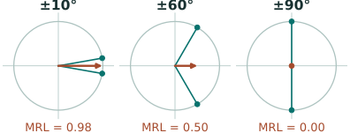

# Circular data basics

Imagine marking the direction each beetle takes as it leaves a round arena.
Two beetles leave at 350° and 10° relative to a light. Both walk nearly
toward it. How can we see that in the numbers?

## A full turn brings you back to the same direction

Cut a paper ring at 0° and lay it flat. The two marks sit near opposite ends
of the strip. Cut the ring at 180° instead and the marks sit side by side at
−10° and 10°. Join the ends and both strips give the same circle. Moving
the cut changes the *coordinates* of a heading. The shortest turn between
the beetles is always 20°.


A direction repeats every full turn, so $-10^\circ$, $350^\circ$, and
$710^\circ$ mark the same point. A count of **turns made** is a different
measurement. A beetle that spins twice before leaving has the same final
heading as one that leaves immediately.

## An angle as a two-dimensional vector

Place the light to the right of the arena and measure angles anticlockwise
from it. A heading $\theta$ is the unit arrow from the center to the point
$(\cos\theta,\sin\theta)$ on the rim. Its first coordinate tells you how
far it points toward the light, and its second how far it points up the
page. At 0° the arrow is $(1,0)$, at 90° it is $(0,1)$, and at 60° it is
approximately $(0.50,0.87)$. Retrieve the angle from the two coordinates
with $\operatorname{atan2}(y,x)$, which uses both signs to find the quadrant.

## Where do the headings point, and how tightly do they cluster?

The arithmetic mean of 350° and 10° is 180°, directly away from the light.
Write those same readings as −10° and 10° and the arithmetic mean becomes
0°. The **circular mean** gives the same answer for either cut. Average the
horizontal components of the unit arrows, then the vertical components.

$$
C=\frac{1}{n}\sum_i\cos\theta_i,\qquad
S=\frac{1}{n}\sum_i\sin\theta_i.
$$

The arrow from the origin to $(C,S)$ is the **mean resultant vector**.
Its direction $\operatorname{atan2}(S,C)$ gives the circular mean when
the arrow has positive length. For these beetles the vertical components
cancel and both horizontal components are about 0.985. Their mean arrow
points directly toward the light.

The arrow's length, $\bar R=\sqrt{C^2+S^2}$, is the **sample mean
resultant length** (MRL). It runs from zero, when the arrows cancel, to one,
when all the headings coincide. Widening the angle between a pair of
headings shortens their mean arrow.



At ±60° each arrow contributes 0.5 toward the light, giving an MRL of 0.5.
At ±90° the two opposing arrows cancel exactly and the mean direction is
undefined. A low MRL can arise from two tight opposing clusters as well
as from headings scattered all around the arena. Inspect the headings
before describing them with a single mean.

## Choose a reference and convert to radians

Use a common zero and a consistent positive direction. Compass bearings
often increase clockwise from north. You can draw a compass dial that
way or convert the bearings to Cartesian angles using
$\theta_{\mathrm{cart}}=\pi/2-\theta_{\mathrm{compass}}$ in radians.
To measure error relative to a cue, subtract the cue bearing from each
heading in the *same* convention and wrap the difference. A compass
heading of 10° with a cue bearing of 350° is 20° clockwise of the cue.

In Python, convert degrees to radians and use `circular_modulo` to put the
differences in $[-\pi,\pi)$. This example uses the light as zero.

```python
import numpy as np
from unwrap.link.numpy import circular_modulo

heading_deg = np.array([350, 10])
cue_deg = 0
relative = circular_modulo(np.deg2rad(heading_deg - cue_deg))
print(np.rad2deg(relative).round(1))  # [-10.  10.]

c, s = np.cos(relative).mean(), np.sin(relative).mean()
mrl = np.hypot(c, s)
print(round(mrl, 3))  # 0.985
if mrl > 1e-12:  # allow for floating-point rounding at cancellation
    print(round(np.rad2deg(np.arctan2(s, c)), 1))  # about 0°
```

**Try it.** Add 40° to each observed heading. The mean direction rotates
by 40° and the MRL stays the same. Next try 300° and 60° with the cue at
zero. The mean direction stays near 0° and the MRL falls to 0.5.

## Try a circular regression

A [von Mises distribution](math/von-mises.md) describes a preferred
direction $\mu$ and how consistently observations cluster around it.
See [how concentration maps to MRL](math/von-mises.md#concentration-and-circular-variation),
then use the [circular GLM guide](models.md) to relate both features to a
predictor. Fit the regression tutorial in
[Python](../notebooks/circular_regression.ipynb) or
[R](../notebooks_r/circular_regression.ipynb).
