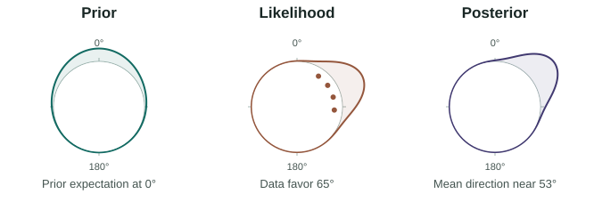
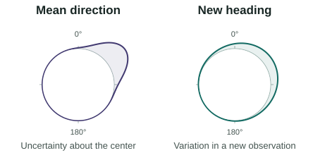

# Bayesian basics

Suppose you record the headings of four beetles leaving a circular arena.
Measured clockwise from a reference cue, the headings are **35°, 55°, 75°,
and 95°**. What do these four directions tell you about where beetles tend
to head under the same conditions? How much variation would you expect in
the next beetle's heading?

## Start with a model for the headings

Use a [von Mises distribution](math/von-mises.md), a circular counterpart
of the normal distribution. Its **mean direction** describes where
headings tend to cluster, and its **concentration** describes how tightly
they cluster. The circle makes 359° and 1° close neighbors.

In this simulated example, each beetle contributes one heading. To focus
on learning the mean direction, we assume independent headings and fix
their concentration at 2. In a full analysis, we can estimate the
concentration too.

## Update the prior with the headings

1. **Prior.** Before seeing the headings, we give more weight to mean
   directions near the reference cue at 0°. We use a broad von Mises
   prior with concentration 2 so directions away from the cue remain
   possible.
2. **Likelihood.** For each possible mean direction, ask how well the
   model predicts the four observed headings. The likelihood is highest
   at 65°, near the middle of the observed headings.
3. **Posterior.** Multiply the prior density by the likelihood, then
   normalize the product. The posterior centers near 53°, between the
   prior preference and the direction favored by the observations. It
   retains uncertainty about the mean direction.



The dots mark observed headings. Each curve shows how its value varies
with the candidate mean direction, with zero at the gray reference ring.
The likelihood is scaled to unit area for display so that all three curves
can share the same radial scale.

Try changing the strength of the prior. In this particular example the
update has a simple calculation. Represent each heading by an arrow of
length 2 and the prior by an arrow of length 2 pointing at 0°. Try prior
arrows of length 0 or 8 in the exercise below. The sum points in the
posterior mean direction.

```python
from cmath import exp, phase
from math import degrees, radians

headings = [35, 55, 75, 95]
data_vector = 2 * sum(exp(1j * radians(heading)) for heading in headings)

for prior_strength in (0, 2, 8):
    mean_direction = degrees(phase(data_vector + prior_strength))
    print(f"Prior strength {prior_strength}: {mean_direction:.1f}°")
```

## Predict a new heading

The posterior describes uncertainty about the **mean direction**. To
predict the **next beetle's heading**, draw a possible mean direction
from the posterior, then draw a heading from the von Mises distribution
with that center and the assumed concentration. Repeating these two
steps gives the posterior predictive distribution.



The prediction combines uncertainty about the mean with variation among
individual headings. Collecting more headings can narrow uncertainty
about the mean even if beetles remain just as variable.

## Check what the model can reproduce

- **Before fitting, simulate from the prior.** Draw possible mean
  directions and simulate four headings under each one. Would the
  resulting clusters look biologically plausible in this arena?
- **After fitting, simulate from the posterior.** Again simulate four
  headings at a time. Compare their directional consistency with that
  of the four observed headings, for example using the
  [mean resultant length](math/von-mises.md#concentration-and-circular-variation).
  If the simulated headings rarely cluster as strongly as the
  observations, the assumed concentration may be too low. Reproduce the
  sampling design when checking a real study, including the number of
  animals and observations per animal.

## Try a circular regression

The [circular regression tutorial](examples.md#the-tutorial) fits a model
in Python or R, lets the predictors affect mean direction and
concentration, and uses simulated headings to check the fit. For an
interactive view of how directional observations and posterior
uncertainty relate, [run the MCMC explorer](mcmc.md). It lets you compare four
chains and inspect the headings a fitted model predicts. The [prior guide](priors.md)
shows what prior choices imply about turns and directional consistency.
