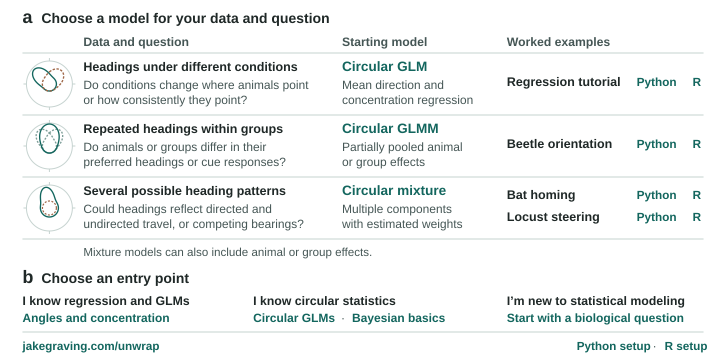

# Choose a circular model

Start with what you measured and what you want to learn. Suppose you recorded
an animal’s heading as it left an arena. You might ask where it tended to
point, how consistently it pointed there, or whether it used more than one
direction. The same dataset can support different questions.

[Open the linked model map](assets/unwrap-model-map.svg)

## Start from your data and question

The case studies below use repeated measurements from individual animals.

| Your data and question | Starting model | Worked examples |
| --- | --- | --- |
| **Treatment groups.** Does a treatment change the preferred heading or how consistently individuals orient? | [Circular GLMM](math/glmms.md). Estimate treatment effects on mean direction, concentration, or both while accounting for repeated measurements. | Beetle light pollution ([Python](notebooks/beetles.ipynb) · [R](notebooks_r/beetles.ipynb)) tests how artificial light changes exit bearings. Zebra escape response ([Python](notebooks/zebra_escape.ipynb) · [R](notebooks_r/zebra_escape.ipynb)) compares body orientation before and after a disturbance. |
| **Continuous predictors.** Does directional alignment change along a gradient or with several continuous predictors? | [Circular GLMM](math/glmms.md). Relate mean direction or concentration to continuous predictors, with group effects for repeated observations. | Locust order and density ([Python](notebooks/locust_density_order.ipynb) · [R](notebooks_r/locust_density_order.ipynb)) for directional alignment. |
| **Mixtures.** Could headings reflect distinct movement processes or competing preferred directions? | [Circular mixture GLMM](math/mixtures.md). Estimate separate heading components and their weights within a multilevel model. | Bat homing ([Python](notebooks/goldshtein_bats.ipynb) · [R](notebooks_r/goldshtein_bats.ipynb)) for directed and uniform components. Locust decision-making ([Python](notebooks/locust_direction_mixture_model.ipynb) · [R](notebooks_r/locust_direction_mixture_model.ipynb)) for optic flow versus vectorial encoding. |

For a single set of headings with no predictors, start with a
[von Mises distribution](math/von-mises.md) to estimate mean direction and
concentration. If the thing you measure is a rate or a count that varies
with time of day, time is periodic but your outcome is not an angle. The
[daily activity example](examples.md#periodic-but-not-circular-a-24-hour-activity-rhythm)
shows how to put the periodicity in the predictor.

Let the sampling design guide the grouping structure. Repeated observations
from the same animal share animal-level variation. Closely spaced steps can
also depend on preceding steps. Use the biological question and predictive
checks to decide whether another component is warranted.

## Start from what you know

- **I know regression and GLMs.** Start with [Angle basics](angle-basics.md).
  Then see how [circular and positive links](links.md) map linear predictors
  to mean direction and concentration.
- **I know circular statistics.** Start with [Bayesian basics](bayes-basics.md)
  to see what changes after you observe headings. Then read the
  [circular GLM guide](models.md#from-a-biological-question-to-a-glm) to see
  where predictors enter the model.
- **I’m new to statistical modeling.** Start with the
  [biological questions](index.md#start-with-a-biological-question), then
  work through [Angle basics](angle-basics.md) and
  [Bayesian basics](bayes-basics.md).
- **I’m using a coding agent.** Use the [copyable prompt](coding-agents.md#copyable-prompt)
  to describe your question and data, find a relevant example, and check the fit.

## Fit a first model

Run the simulated circular regression tutorial in
[Python](notebooks/circular_regression.ipynb) or
[R](notebooks_r/circular_regression.ipynb). It generates its own data and
shows how to fit the model, interpret its predictions, and compare those
predictions with the observed headings. Follow the
[Python setup](getting-started.md) or [R setup](getting-started-r.md)
instructions to run it locally.
