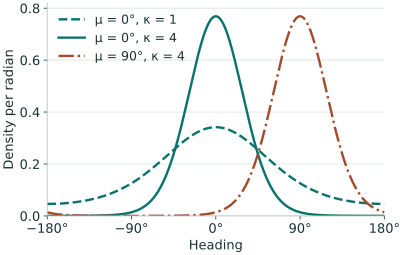
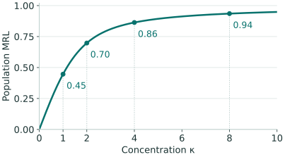

# 1. The von Mises distribution

An animal's headings may cluster around one direction, with some variation
from observation to observation. The von Mises distribution describes this
pattern on the circle. It is the observation model used throughout the
[GLM](glms.md), [GLMM](glmms.md), and [mixture](mixtures.md) extensions below.

The [conceptual guide](../models.md) introduces the same ideas through
biological questions and Bambi formulas.

| Level | Biological question | Model |
| --- | --- | --- |
| 1. [Von Mises](von-mises.md) | Where do headings cluster, and how tightly? | One circular distribution |
| 2. [GLMs](glms.md) | How do treatments or continuous predictors change heading? | Regression for mean direction and concentration |
| 3. [GLMMs](glmms.md) | How do animals differ around the population response? | Partially pooled animal or group effects |
| 4. [Mixtures](mixtures.md) | Are headings consistent with more than one process or preferred direction? | Weighted combinations of circular distributions |

## A likelihood for angular observations

For a heading $y$, mean direction $\mu$, and concentration $\kappa$, the density is

$$
\mathcal{M}(y\mid\mu,\kappa)
=\frac{\exp\!\left[\kappa\cos(y-\mu)\right]}{2\pi I_0(\kappa)},
\qquad \kappa\geq 0.
$$

| Symbol | Meaning |
| --- | --- |
| $y$ | An observed angle in radians |
| $\mu$ | Mean direction, around which observations cluster |
| $\kappa$ | Concentration (larger values give tighter clustering) |
| $I_0(\kappa)$ | The modified Bessel function of the first kind, order zero |
| $2\pi I_0(\kappa)$ | The normalising factor, also written $Z(\kappa)$; it makes the density integrate to one |

The cosine measures agreement between an observation and the mean direction.
It treats directions a full turn apart as identical. Concentration controls
how strongly observations cluster around that mean. At $\kappa=0$, the density
is uniform, $1/(2\pi)$, and no mean direction is preferred. Positive values
describe progressively stronger directional consistency.



Read the teal curves first. Increasing $\kappa$ from 1 to 4 keeps $\mu=0^\circ$
and moves probability toward the light. Compare the narrow teal curve with
the rust curve. Shifting $\mu$ by a quarter turn moves the peak to 90° and
preserves its shape. Each curve joins smoothly at the two ends of the
horizontal axis.

This is a **probability density** over angles. A probability for an angular
range is found by integrating the density over that range; the height at an
exact direction is not a probability.

## Angular conventions

See [Angle basics](../angle-basics.md) for visual examples of wraparound,
mean direction, and concentration.

All model equations use radians. The circular-modulo link represents
angles in $[-\pi,\pi)$. The alternative $(-\pi,\pi]$ convention uses the same circle, since the endpoints describe the same direction. Keep the angular origin
and clockwise or anticlockwise convention consistent across observations and
predictions.

## Concentration and circular variation

For a von Mises distribution, the mean resultant length is

$$
R(\kappa)=\frac{I_1(\kappa)}{I_0(\kappa)},
\qquad V=1-R(\kappa).
$$

$I_1$ is the modified Bessel function of order one. $R(\kappa)$ gives the
length of the *population* mean vector, and $V$ is the circular variance.
You can read the relationship in either direction. At $\kappa=2$ the
population MRL is about 0.70. A population MRL of 0.86 corresponds to a
$\kappa$ close to 4. Doubling $\kappa$ from 4 to 8 increases the MRL only
from 0.86 to 0.94, as the curve approaches its upper limit of one.



The [sample MRL](../angle-basics.md#where-do-the-headings-point-and-how-tightly-do-they-cluster)
varies from sample to sample. For independent observations from a single
von Mises distribution, a sample with $0<\bar R<1$ has a maximum-likelihood
concentration estimate given by $R(\hat\kappa)=\bar R$. Exact cancellation gives $\hat\kappa=0$. If all headings
coincide, $\bar R=1$ and the estimate tends to infinity. This conversion
assumes one common mean and concentration. Pooling across conditions that point in different directions
can shorten the sample mean vector, even when each condition has tightly
clustered observations.

The [Bessel helpers](../api.md#concentration-conversion-unwrapbessel) work
on the population relationship in either direction.

```python
from unwrap.bessel import bessel_ratio, inverse_bessel_ratio

print(round(bessel_ratio(2), 3))             # 0.698
print(round(inverse_bessel_ratio(0.86), 2))  # 3.91
```

Higher $\kappa$ means individual headings are more consistent. Precision
in an *estimated mean direction* also depends on how many independent
observations you collect. The [Bayesian basics guide](../bayes-basics.md)
illustrates both sources of uncertainty.

Continue to [circular GLMs](glms.md) to relate mean direction and concentration to predictors.
