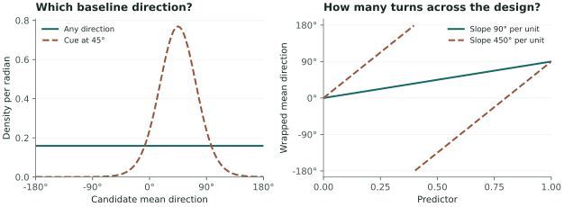
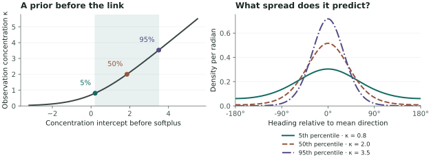
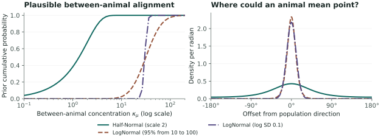
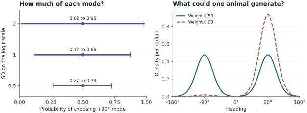

# Choosing priors for circular models

Before collecting a single heading, what turns would you believe an animal
could make? How consistently might it repeat them? In a [circular
regression](regression-basics.md), different priors answer those questions.
The examples below follow the “Priors for Circular GLMs” and mixture-weight
appendices of *Unwrapping Circular Statistics with Bayesian Multilevel
Models* ([paper citation](index.md#citation)). All model angles are in radians.
The figures label angles in degrees.

## Mean direction and angular change

When any baseline direction is plausible, use a circular-uniform intercept.
The package's `CircularUniformPrior()` implements this with a von Mises
distribution whose concentration is machine epsilon. If an earlier experiment
instead locates a cue at 45°, a von Mises prior centered there can encode
that information. Its concentration describes your uncertainty about the
**population mean direction**. Animals can still scatter widely around it.



*Left, the cue-centered example has concentration 4. Right, observe only
the endpoints and both slopes predict a 90° shift. At the halfway point
they predict 45° and −135°, respectively.*

For a binary treatment, a single signed rotation in $[-\pi,\pi)$ describes
the contrast. A zero-centered von Mises slope prior favors small turns as
its concentration increases. For a continuous predictor, the slope is an
angular **rate** and can exceed $\pi$ radians per unit. A zero-centered
Normal prior allows these rates. With a standardized predictor, the paper
suggests trying standard deviations from $\pi/4$ to $\pi$ and inspecting
the number of turns over the actual predictor range. For example,
a slope of $\pi/2$ predicts a quarter turn per predictor standard deviation.

## Concentration on the scale of observed headings

The model draws its concentration intercept $\alpha_0$ and slope $\alpha_1$
on the real line, then maps them to positive values through
$\kappa(x)=\log(1+\exp(\alpha_0+\alpha_1x))$. The manuscript considers
intercept priors centered at 1 or 3 before this softplus link. They give median
baseline concentrations of 1.31 and 3.05, respectively, for symmetric Normal
priors. Near-zero $\kappa$ makes almost every heading equally likely, leaving
little information about mean direction.



*The paper's worked regression centers a Normal intercept prior at
`inverse_softplus(2.0)` with standard deviation 1. Shading spans the middle
90% before the link. The three dots give three possible distributions for
individual headings about the same mean.*

The worked example gives $\alpha_1$ a zero-centered Normal prior with
standard deviation 0.5. At the median baseline $\kappa=2$, a one-unit
increase in the predictor with $\alpha_1=0.5$ takes $\kappa$ to 2.45.
The change depends on the starting value. For standardized predictors,
the appendix also explores broader slope scales of 1–3. Check the heading
spread implied at both ends of your design before choosing a scale.

## How tightly do animal means cluster?

In a [hierarchical model](math/glmms.md), the angular offset of animal $i$
can have a $\mathrm{vonMises}(0,\kappa_\mu)$ prior. High $\kappa_\mu$ pulls
animal **means** together. The observation-level $\kappa$ describes scatter
among **headings** given an animal's mean. Each animal can repeat its own
heading reliably even if the animals point in different directions.



*The left axis gives the probability below each concentration. On the right,
each curve averages over its entire hyperprior to predict an animal's
baseline angular offset. Zero is the population direction.*

The paper calibrates a LogNormal hyperprior by specifying a central 95%
interval $[L,U]$ for $\kappa_\mu$. On the natural-log scale, choose the mean
$(\log L+\log U)/2$ and standard deviation $(\log U-\log L)/(2\times1.96)$.
An interval of 10–100 gives a median of 31.6 and log-scale SD of 0.59.
Another example with median 30 and log-scale SD 0.1 places 95% between about
25 and 36. The latter makes a much firmer assumption about the amount of
pooling. Compare estimates under a broader hyperprior when that assumption
matters to the scientific conclusion.

For a **Gaussian** animal-specific slope or pre-softplus offset, model
the offset as $\mathrm{Normal}(0,\tau^2)$ and give its standard deviation
$\tau$ a half-Normal or half-Student-$t$ prior. Here *small* $\tau$ pools
animals together. For angular offsets, *large* $\kappa_\mu$ pools them.
The half-Normal example in the figure illustrates what happens if a scale
prior favoring small numbers is applied to a concentration. When several
Gaussian offsets vary together, the paper also discusses an LKJ prior on
their correlation matrix alongside separate priors for their scales.

## Could one animal use both modes?

In a [two-component mixture](math/mixtures.md), an animal with weight
$\omega_i=0.5$ chooses either component equally often. One with
$\omega_i=0.98$ usually uses the same component. A prior on the logit of
$\omega_i$ distinguishes these behaviors even when the two groups of
headings look similar after pooling animals.



*Left, the animal logits have mean zero. The dot marks the median weight.
Right, both directional components have concentration 6 and centers at
−90° and +90°. Only the weight changes.*

The paper suggests tighter Normal offsets on the logit scale when animals
switch between strategies, and wider or heavier-tailed offsets when
different animals tend to commit to different strategies. A baseline prior
centered at $\operatorname{logit}(0.9)$ gives a median weight of 0.9 when
one strategy is expected to dominate. For more than two components, a
softmax with a reference component or sum-to-zero constraint converts
predictors into weights that sum to one. A fixed weight vector can instead
use a symmetric Dirichlet prior with parameter below one when a few
components are expected to dominate. If there is independent reason to
expect distinct directions, the paper illustrates centering component means
around evenly spaced angles with a shared, unknown rotation.

## Simulate before fitting

Simulate whole experiments with the proposed priors. A flat prior for the
baseline direction can make headings pooled across simulations look uniform
even when the animals within each simulated experiment are tightly aligned.
Compute a circular summary *inside each experiment*, then examine its spread
across experiments. This example uses the paper's worked regression priors,
three standardized predictor values and 20 headings per value.

```python
import numpy as np

rng = np.random.default_rng(163)
x = np.array([-1.0, 0.0, 1.0])
n_sim = 2000
# One shared set of coefficients per hypothetical experiment.
beta0 = rng.uniform(-np.pi, np.pi, (n_sim, 1))
beta1 = rng.normal(0, np.pi / 2, (n_sim, 1))
alpha0 = rng.normal(np.log(np.expm1(2.0)), 1, (n_sim, 1))
alpha1 = rng.normal(0, 0.5, (n_sim, 1))
mu = (beta0 + beta1 * x + np.pi) % (2 * np.pi) - np.pi
kappa = np.logaddexp(0, alpha0 + alpha1 * x)
headings = rng.vonmises(mu[..., None], kappa[..., None], (n_sim, len(x), 20))
mrl = np.abs(np.mean(np.exp(1j * headings), axis=-1))

for value, sample in zip(x, mrl.T):
    lower, median, upper = np.quantile(sample, [0.05, 0.5, 0.95])
    print(f"x={value:+.0f}  median MRL {median:.2f}  (90% range {lower:.2f}–{upper:.2f})")
```

At baseline the median simulated [mean resultant length](angle-basics.md) is
0.72, with 90% of experiments between 0.36 and 0.88. Does that range
include the directional consistency you would expect in a group of that
size? Repeat with your predictor range and trial counts. For a hierarchical
model, draw each animal's offset once and reuse it for all of its trials.
For a mixture, also check the fraction of animals with weights below 0.1
or above 0.9. These checks need no observations or fitted chains.
The [MCMC explainer](mcmc.md) shows how observed headings then update a prior.
