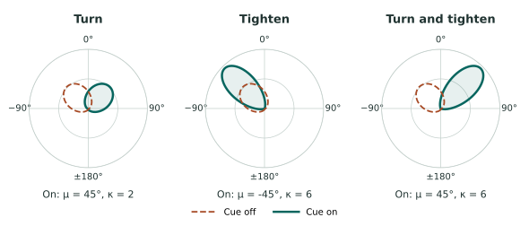
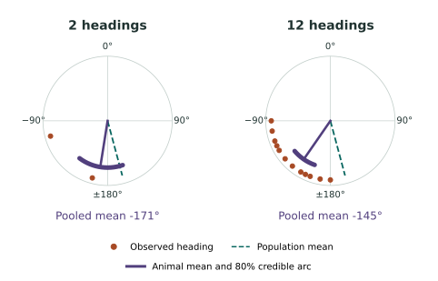

# Reading a circular regression

Suppose a beetle leaves an arena several times with a light off and several
more times with it on. Does the light turn the beetle? Does it make the
beetle’s exits more repeatable? Do all beetles respond alike? Each trial
contributes one heading, but its position on the circle carries information
about all three questions.

## A cue can turn headings, tighten them, or do both

A circular generalized linear model (GLM) assigns a [von Mises
distribution](math/von-mises.md) to the heading observed on each trial. The
mean direction $\mu$ locates the peak. The concentration $\kappa$ controls
how closely headings cluster around that direction.

Read each curve around the compass. The farther the curve lies from the
center at a bearing, the higher the probability density there. The rings
mark 0.5 and 1 per radian in all three panels. The dashed curve is the same
in every panel, with $\mu=-45°$ and $\kappa=2$ when the light is off. The
solid curves illustrate three possible responses to the light. A change
in peak **position** indicates turning. A change in **width** indicates a
change in consistency. In the right panel the peak gets sharper even though
it stays the same angular distance from the reference bearing of 0°.

With `cue` coded as 0 for off and 1 for on, a distributional GLM can express
all three responses using two equations for one set of observed headings.

$$
\begin{aligned}
\mu(x) &= \operatorname{wrap}(\beta_0+\beta_1 x),\\
\kappa(x) &= \operatorname{softplus}(\alpha_0+\alpha_1 x).
\end{aligned}
$$

The [inverse links](links.md) keep $\mu$ on the circle and $\kappa$ positive.
The mean slope $\beta_1$ is a rotation in radians. In the right panel the
light turns the peak clockwise through $\pi/2$. The concentration changes
from 2 to 6 in that panel, while $\alpha_1$ measures the change *before*
softplus. Setting $\alpha_1=0$ gives the left panel. Setting $\beta_1=0$
while retaining the concentration effect gives the middle panel. With a
continuous predictor, the same equations supply a distribution at every
predictor value.

## What a Bayesian fit learns

The [Bayesian basics example](bayes-basics.md) shows how four headings
update a prior on one mean direction. In regression, a candidate set of
coefficients predicts both $\mu$ and $\kappa$ at every observed cue value.
The likelihood measures how well those distributions explain the recorded
headings. The posterior combines that likelihood with the [priors on the
coefficients](priors.md). Its draws preserve uncertainty about *both*
responses to the light and how they vary together.

For each posterior draw, compute the two cue-specific means and
concentrations. Measure the turn as $\operatorname{wrap}(\mu(1)-\mu(0))$
and the change in consistency as $\kappa(1)-\kappa(0)$. For example, a
move from $170°$ to $-175°$ is a clockwise turn of $15°$ on this compass.
To predict a **new observation**, sample a heading from the von Mises
distribution at the chosen cue value in each draw. Compare replicated
headings with the data in each condition. Can the model reproduce both
their circular mean and their [mean resultant length](math/von-mises.md#concentration-and-circular-variation)?
The [MCMC explainer](mcmc.md) shows how a sampler explores a posterior.

## How repeated headings share information

A circular generalized linear mixed model (GLMM) retains the cue effects
and adds parameters for individual beetles. For example, the baseline
direction for animal $i$ can be $\operatorname{wrap}(\beta_0+b_i)$, and
its cue response can be $\beta_1+b_{1i}$. A separate offset $a_i$ in
$\operatorname{softplus}(\alpha_0+a_i+\alpha_1 x)$ allows some beetles to
be more consistent than others under the same light. The offsets come
from shared population distributions. The scale or concentration of a shared
distribution controls how similar the animals tend to be. Giving that
parameter a prior of its own lets the data inform how much information
animals share. This is the hierarchy behind **partial pooling**.

Here we hold the cue fixed and isolate one level of the hierarchy. Both
animals have an observed circular mean of $-135°$ and a similar spread of
headings. Suppose the population direction is known to be $165°$, with
between-animal concentration 5, and each animal’s individual headings
have within-animal concentration 2. The purple line is the posterior mean
direction for that animal. The arc contains 80% of the posterior for its
mean direction. More headings give the second animal a shorter arc and
pull its estimate closer to its own observed mean. The first estimate
borrows more from the population, across the $\pm180°$ seam.

These are exact conditional updates using the [vector addition from the
Bayesian primer](bayes-basics.md#update-the-prior-with-the-headings). Each
observed heading contributes a vector of length 2. A population vector of
length 5 points at $165°$. Their sum points in the animal’s estimated
direction. In a fitted hierarchy, the population direction and spread can
also have posterior uncertainty. The [GLMM mathematical guide](math/glmms.md)
shows both circular offsets and offsets on the regression predictor scale.

For a prediction about a beetle already measured, use its fitted offsets.
For a **new beetle**, draw a new set of offsets from the population for each
posterior draw. Reuse those offsets across that beetle’s simulated trials.
This preserves the distinction between how steadily one beetle points and
how much preferred headings vary across beetles.

[Fit the simulated GLM in Python](../notebooks/circular_regression.ipynb) or
[R](../notebooks_r/circular_regression.ipynb). For repeated observations, the
[beetle study](examples.md#artificial-light-reorients-nocturnal-dung-beetles) shows how animal-level effects enter the model.
