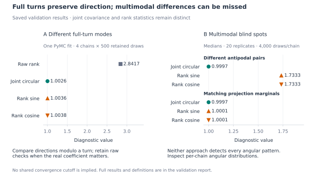

# Circular diagnostic validation

## Summary

- **Tested:** 600 synthetic four-chain draw sets across 10 scenarios, plus rotation checks and 2 four-chain PyMC fits with mixed-posterior API checks.
- **Why:** Distinguish disagreement in angular directions from different numerical representations of the same direction, and check that ordinary parameters retain ArviZ behavior.
- **Found:** The period-separated fit gave raw R-hat 2.8417 and joint circular R-hat 1.0026. Ordinary-variable outputs matched ArviZ exactly. The joint method detected tested differences in direction and concentration, plus within-chain shifts. Both it and the separate projections have multimodal blind spots; averaging the projection R-hats can obscure an elevated value.
- **Use:** Select angular quantities with `circ_var_names`, report the joint and both projection R-hats, and inspect per-chain angular distributions. Retain raw coefficient diagnostics when that scale matters. The joint statistic has no calibrated universal cutoff.



Left: one PyMC fit distinguishes real coefficient modes from directional agreement. Right: selected simulation medians show that neither approach detects every angular difference. Joint circular values and rank R-hats are different statistics.

This reproducible study compares the joint covariance diagnostic with separate
ArviZ rank R-hats on sine and cosine. The maximum and arithmetic mean of those
two R-hats are included only as exploratory comparisons; neither is a public
aggregate API or a separately calibrated convergence criterion.

See [the mathematical and API guide](../diagnostics.md) and
[the script](https://github.com/jgraving/unwrap/blob/feat/circular-rhat/examples/circular_rhat_validation.py).

## Design

The simulation has 600 four-chain draw sets: ten scenarios,
20 seeds, and lengths [200, 1000, 4000] per chain.
Most controls are independent draws. The stationary AR(1) control uses
autocorrelation 0.95 and starts in its stationary distribution. Antipodal
controls balance opposite directions within each half-chain, exposing a
known first-moment limitation without singular within-chain covariance.
All data and sampler seeds are recorded in the JSON results.

The 1.01 exceedance rates in the JSON are descriptive. In particular, a
large value for finite autocorrelated draws from one stationary target is
evidence of limited finite-run agreement, not proof of a different target.
This study does not calibrate a universal threshold or prove convergence.

## Simulation medians at 4,000 draws per chain

| Scenario | Joint circular | Rank sine | Rank cosine | Component max | Component mean | Rank wrapped angle |
| --- | ---: | ---: | ---: | ---: | ---: | ---: |
| iid_same_target | 1.0001 | 1.0000 | 1.0000 | 1.0001 | 1.0000 | 1.0000 |
| whole_turn_offsets | 1.0001 | 1.0000 | 1.0000 | 1.0001 | 1.0000 | 1.0000 |
| near_branch_cut | 1.0001 | 1.0000 | 1.0000 | 1.0001 | 1.0000 | 1.0000 |
| different_mean_directions | 2.9828 | 1.7173 | 1.7112 | 1.7173 | 1.7144 | 1.7219 |
| different_concentrations | 1.1370 | 1.1845 | 1.0980 | 1.1845 | 1.1412 | 1.1979 |
| within_chain_shift | 2.9927 | 1.5078 | 1.7221 | 1.7221 | 1.6147 | 1.7141 |
| stationary_ar1 | 1.0151 | 1.0116 | 1.0084 | 1.0121 | 1.0101 | 1.0122 |
| different_antipodal_pairs | 0.9997 | 1.7333 | 1.7333 | 1.7333 | 1.7333 | 0.9998 |
| same_projection_marginals | 0.9997 | 1.0001 | 1.0001 | 1.0001 | 1.0001 | 1.1529 |
| small_direction_difference | 1.0161 | 1.0144 | 1.0001 | 1.0144 | 1.0072 | 1.0144 |

Whole-turn offsets leave the angular diagnostics unchanged. Joint circular
R-hat detects the tested mean-direction, concentration, and within-chain
shift differences. Its first-moment limitation is visible for balanced
antipodal pairs: different angular distributions can share the same mean
unit vector. The sine/cosine checks detect some such cases but can themselves
miss distributions with matching projection marginals. Neither approach
dominates across these constructed examples.

The small-direction-difference case illustrates why reporting both
components is useful: averaging a larger sine R-hat with a near-unit
cosine R-hat dilutes the visible disagreement.

## Rotation comparison

The same draws from the matching-projection-marginals case are rotated
together. The joint covariance statistic is invariant; separate ranked
projections can change because a rotation changes the scalar projections.

| Rotation | Joint circular | Rank sine | Rank cosine |
| --- | ---: | ---: | ---: |
| 0.0000 | 0.9997 | 1.0007 | 1.0007 |
| 0.7854 | 0.9997 | 1.7335 | 1.7335 |
| 1.5708 | 0.9997 | 1.0007 | 1.0007 |

## Actual PyMC sampling

Two intercept-only von Mises models use four NUTS chains, 500 warmup
iterations and 500 retained draws per chain. Concentration is inferred
with an Exponential prior of mean 8. One initializes the intercept in different whole-turn modes under
a broad Normal(0, 20) prior; the other uses a Normal(π, 0.5) prior and
symmetric data centered on the angular cut. These are smoke experiments
for diagnostic behavior, not a broad sampler benchmark.

| Model | Raw rank R-hat | Joint circular | Rank sine | Rank cosine | Divergences |
| --- | ---: | ---: | ---: | ---: | ---: |
| period_separated_intercepts | 2.8417 | 1.0026 | 1.0036 | 1.0038 | 0 |
| at_branch_cut | 0.9990 | 0.9994 | 0.9990 | 0.9996 | 0 |

The period-separated real intercepts remain in different modes. Their
directions agree after accounting for periodicity. These are different
quantities to diagnose, and the raw coefficient diagnostic is retained.

## Whole-posterior API checks

Each fit retains the real `Intercept`, its wrapped fitted direction `mu`,
and the positive concentration `kappa`. Both angular variables can be
declared in one call while `kappa` retains ordinary ArviZ behavior:

```python
from unwrap.diagnostics import rhat, summary

angular = ["Intercept", "mu"]
rhats = rhat(idata, circ_var_names=angular)
table = summary(idata, circ_var_names=angular)
```

Assertions on both actual posteriors verify exact equality with ArviZ
for ordinary `kappa` R-hat and summary cells. Angular `r_hat` cells equal
the joint circular diagnostic; the additional `_sin` and `_cos` R-hat,
bulk/tail ESS, and mean/SD MCSE columns equal ArviZ diagnostics of the
corresponding projections. Projected MCSEs describe the projections,
not an angular mean or SD. The raw-angle ESS and `mcse_sd` cells are
blank for angular rows; projection columns are blank for ordinary rows.

In the tested ArviZ 0.x version, its own `circ_var_names` option changes
circular descriptive summaries but leaves R-hat and ESS computed on
the raw angles. The wrapper replaces those R-hat cells and reports
explicitly labeled projection diagnostics. The JSON records the
comparison and every mixed summary cell, with blanks represented as null.

| Model | Variable | ArviZ rank R-hat | Mixed R-hat | Rank sine | Rank cosine |
| --- | --- | ---: | ---: | ---: | ---: |
| period_separated_intercepts | Intercept | 2.8417 | 1.0026 | 1.0036 | 1.0038 |
| period_separated_intercepts | mu | 1.0037 | 1.0026 | 1.0036 | 1.0038 |
| period_separated_intercepts | kappa | 1.0063 | 1.0063 | — | — |
| at_branch_cut | Intercept | 0.9990 | 0.9994 | 0.9990 | 0.9996 |
| at_branch_cut | mu | 0.9994 | 0.9994 | 0.9990 | 0.9996 |
| at_branch_cut | kappa | 1.0009 | 1.0009 | — | — |

## Reproduce

```bash
python examples/circular_rhat_validation.py --output docs/validation
python examples/plot_circular_rhat_validation.py
```

The plotting command reads the saved JSON without sampling and requires the PyMC fit results.

Use `--replicates` to change the simulation repetitions or `--skip-mcmc`
to run only the synthetic controls. The JSON records every run and dependency
version. No simulated data are used to alter the diagnostic implementation.
